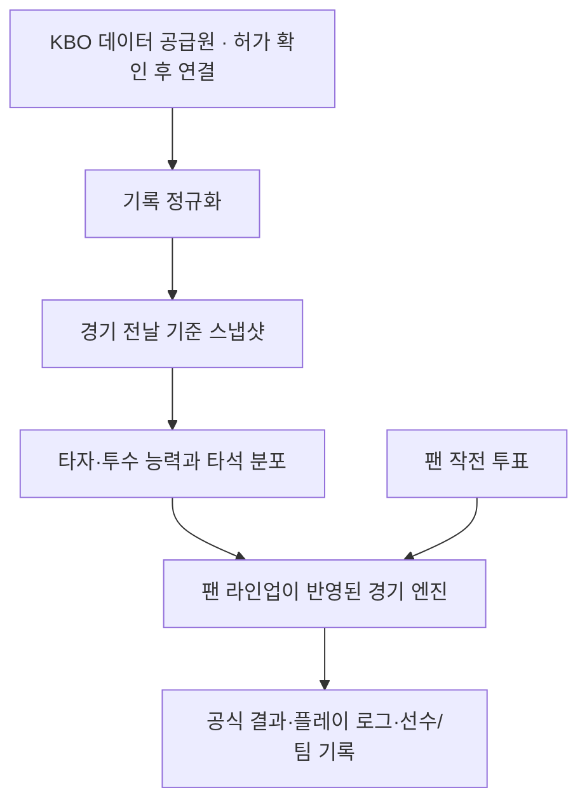

# FanBall | 팬볼

> 실제 KBO 경기의 일정과 선수 기록을 바탕으로, 팬이 직접 구성한 라인업으로 또 하나의 경기를 만드는 야구 시뮬레이션 프로젝트

**FanBall**은 “내가 감독이라면 어떤 라인업을 냈을까?”라는 팬의 선택을 경기로 이어주는 웹앱입니다. 승부를 맞히는 서비스가 아니라, 실제 KBO와 연결된 선수·경기 맥락 위에서 팬들의 선택이 새로운 가상 경기를 만드는 것을 목표로 합니다.

[현재 MVP 열기](https://fanball-kbo-sim.snu-chatgpt-5678.chatgpt.site) · [개발 인수인계](PROJECT_HANDOFF.md) · [변경 기록](CHANGELOG.md)

> **개발 중인 MVP:** 현재 화면의 팀·선수·기록·일정은 샘플 데이터입니다. KBO 공식 일정·기록 API와 라이선스는 아직 연결되지 않았습니다. 경기·투표 저장은 이 브라우저의 `localStorage`를 사용합니다.

## 제품 방향

팬볼의 공식 경기는 실제 KBO 경기 한 건에 하나씩 대응합니다. 경기 당일 발표된 라인업과 경기 전날까지의 선수 기록을 사용하고, 각 팀 팬은 자기 응원팀의 타자 라인업을 만듭니다. 선발투수는 팬이 투표하지 않고 KBO가 발표한 선발을 사용합니다.

양 팀의 대표 라인업이 확정되면 팬볼 경기를 한 번 진행합니다. 팬은 주요 상황에서 작전을 투표하고, 모든 사용자는 같은 공식 결과를 확인하는 구조를 목표로 합니다.

## 현재 MVP

- 응원팀 선택 후 해당 팀의 타순과 수비 포지션 편성
- 타순 변경 시 선택 위치로 선수를 이동하고 나머지 타순을 자동 정렬
- 라인업 제출 후 홈 버튼이 `라인업 수정하기`로 바뀌며 제출 상태 저장
- 같은 포지션에 선수를 배치하면 기존 선수를 원래 포지션으로 자동 교체
- 타자 AVG·OPS와 상대 선발 기준 AVG 참고 영역
- 투수별 구종 속도, 2초 간격의 연속 좌표 투구 위치(볼은 존 바깥), 정사각형 3×3 스트라이크존, 2아웃 카운트 표시
- 타석 결과별 100,000회 빈도 분포와 실제 적용 결과 조회
- 타석 결과를 2초간 강조한 뒤 다음 타자로 이동
- 현재 이닝·아웃·주자 상황에 따라 강공·컨택·희생번트 작전과 결과 반영
- 라인업 작성 화면에 당일 공식 라인업 참고 영역(공식 데이터 연결 전에는 연결 대기 상태 표시)
- 경기 및 결과 화면에서 샘플 경기 초기화 후 재실행
- 경기별 스코어, 타석 로그, 선수 기록, 팬 작전 투표 및 순위 화면
- 관리자 모드의 샘플 경기·라인업 초기화 및 즉시 시작
- 열어둔 크롬 탭이 새 배포를 감지해 같은 탭에서 자동 새로고침

샘플 9이닝 경기는 약 96타석·398구가 나와 투구만 약 13분 16초가 걸렸습니다. 중요 상황 투표를 15초까지 기다리면 이 샘플은 약 22분 25초, 빠르게 투표하면 대략 16~18분 수준입니다. 경기마다 타석 수와 투표 횟수에 따라 달라지며, 20분 운영 창에 최대 진행 시간은 맞지 않을 수 있습니다.

타석 엔진은 각 결과의 100,000회 표본 빈도를 만든 뒤 그 비율에 따라 결과 하나를 뽑습니다. 최빈 결과를 매번 고정하지 않으므로 아웃 빈도가 가장 높더라도 모든 타석이 아웃이 되지는 않습니다. 현재 확률값과 상대 선발 스플릿은 화면 검증용 샘플입니다.

## 경기 운영 구상

| 시각 | 운영 |
|---|---|
| 평일 17:30 / 주말·공휴일 13:00 | KBO 당일 선발 라인업 확인 및 팬볼 대표 라인업 확정 |
| 18:00 | 팬볼 공식 시뮬레이션 시작 |
| 18:00–18:20 | 투구 연출과 중요 상황 팬 작전 투표 진행 |
| 경기 종료 후 | 결과, 타석별 분포, 선수 기록과 팀 순위 공개 |

시간과 투표 규칙은 현재 제품 합의안입니다. 앱의 샘플 경기는 시간대와 무관하게 수동 시작할 수 있습니다.

## 기술 구성

현재 MVP는 별도 프레임워크 없이 HTML, CSS, JavaScript로 구성된 정적 반응형 웹앱입니다.



이 도식은 목표 아키텍처입니다. 현재 배포본은 샘플 데이터와 브라우저 저장소를 쓰는 정적 MVP입니다.

### 저장소 구성

```text
.
├── dist/
│   ├── index.html          # 앱 진입점
│   ├── style.css           # 반응형 스타일
│   ├── app.js              # 기본 화면 및 샘플 게임 엔진
│   └── enhancements.js     # 라인업 교체, 투구 연출, 분포 기반 결과 추첨
├── docs/
│   ├── PRODUCT_BRIEF.md    # 제품 개요와 사용 흐름
│   ├── DECISIONS.md        # 확정 규칙과 MVP 임시 결정
│   ├── ROADMAP.md          # 개발 단계와 미완료 항목
│   └── STRATEGY_DESIGN.md  # 작전 상황표·트레이드오프·계수·출처·보정 절차
├── CHANGELOG.md
└── PROJECT_HANDOFF.md
```

## 로컬 실행

Python 3가 설치되어 있다면 프로젝트 루트에서 실행합니다.

```bash
python3 -m http.server 8000 --directory dist
```

브라우저에서 `http://localhost:8000`을 엽니다. JavaScript 구문 확인:

```bash
node --check dist/app.js
node --check dist/enhancements.js
```

## 데이터 권리와 정확성

KBO 사이트를 열람할 수 있다는 사실만으로 데이터 자동수집이나 상업적 이용 권한이 생기지는 않습니다. 공식 API 또는 서면 허가를 확인한 뒤 일정·선수 명단·기록 공급원을 연결합니다. 구단 로고와 선수 사진도 별도 이용 권리를 확인합니다. 샘플 데이터와 실제 KBO 데이터는 공급자 계층에서 분리하고, 팬볼 기록은 실제 선수 능력치에 섞지 않습니다.

## 다음 개발 목표

1. KBO 또는 정식 데이터 공급원의 일정·선수·기록 이용 조건 확인
2. 날짜별 KBO 기록 제공 계층과 경기 전날 기준 능력치 스냅샷 구현
3. 실제 시즌 상대 선발 스플릿과 표본이 적은 선수의 보정 규칙 검증
4. 서버·DB에 라인업, 투표, 경기 시드, 결과와 플레이 로그 저장
5. 공식 경기의 단일 실행과 동시 중복 요청 방지
6. 투구·주자 이동·병살·끝내기·연장 및 타자·투수 공식 기록 계산 개선

세부 일정과 결정 배경은 [제품 개요](docs/PRODUCT_BRIEF.md), [결정 기록](docs/DECISIONS.md), [로드맵](docs/ROADMAP.md), [작전 설계·근거 기록](docs/STRATEGY_DESIGN.md)를 참고하세요.
